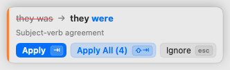
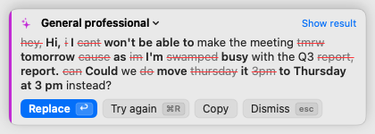

# Nib

**Grammar fixes, live underlines and rewrites in any Mac app, with the AI provider you choose.**

Nib lives in the menu bar. It underlines spelling, grammar and wording mistakes as you type, fixes a whole field with a double-tap of ⌥ Option, and rewrites a selection in the tone you pick. It works in most apps: TextEdit, Notes, Mail, Messages, Safari, Chrome and other Chromium browsers, and Electron apps such as Slack. There's experimental support for VS Code.

Nib is free and open source (MIT). There's no Nib account and no Nib server: your text goes straight from your Mac to the AI provider you pick, with your own API key.

**Website:** <https://wangrui-uk.github.io/nib/> · **Download:** [latest release](https://github.com/wangrui-uk/nib/releases/latest)

<p align="center">
  
  
</p>

## Features

- **Live checking.** Wavy underlines as you type: red for spelling, orange for grammar, grey for wording. Hover over one, or put the cursor in it, for a popup with the fix and the reason. Then **Apply ⇥**, **Apply All ⇧⇥** or **Ignore esc**.
- **Correct a field: ⌥⌥** (double-tap Option). Fixes the selection, or the whole field if nothing is selected. Choose to apply straight away or see the changes first. **⌃⌥Z** undoes the correction.
- **Rewrite a selection: ⇧⇧** or the ✨ button. Rewrites in 13 editable styles (professional, concise, friendly, formal, apology, polite decline…) or your own.
- **Pause: ⌘⌘.** While paused, nothing is read and nothing is sent.
- **Your choice of AI:** Gemini (AI Studio or Vertex AI), Claude, OpenAI, DeepSeek, Qwen, or any OpenAI-compatible server, including local ones like Ollama or LM Studio.
- **Careful with your text.** Only the changed words are written back, so formatting is kept. Every write is read back to confirm it worked. Password fields and terminals are never read.

## Install

1. Download `Nib-<version>.dmg` from the [latest release](https://github.com/wangrui-uk/nib/releases/latest). It's signed with a Developer ID and notarised by Apple.
2. Open the DMG, drag **Nib** to **Applications**, and open it.
3. The setup guide walks you through the rest:
   - **Allow Accessibility.** Nib needs it to read and fix the text in other apps.
   - **Pick a provider and paste your API key.** Keys are stored in your login Keychain. See [Setup](https://wangrui-uk.github.io/nib/setup.html) for how to get a key from each provider.
   - **Read the privacy note and confirm.** Live checking starts only after you confirm.

Nib needs macOS 13 or later. It updates itself: Nib checks for new versions automatically (you can turn this off), or use **Check for Updates…** in the menu.

## Shortcuts

| Shortcut | What it does |
|---|---|
| **⌥⌥** (tap Option twice) | Correct the selection, or the whole field |
| **⇧⇧** (tap Shift twice) | Rewrite the selection |
| **⌘⌘** (tap Command twice) | Pause or resume Nib |
| **⌃⌥Z** | Undo the last correction |
| In a popup: **⇥** / **⇧⇥** / **esc** | Apply / Apply all / Ignore |
| In a card: **↩** / **⌘R** / **esc** | Accept or replace / Try again / Dismiss |

A double-tap counts only when the key is tapped on its own, so typing with ⌥, ⇧ or ⌘ never triggers it. You can switch ⌥⌥ and ⌘⌘ to regular shortcuts in Settings.

## Privacy

- Your text goes **only to the provider you choose, with your own key**. There's no Nib server, no account, no analytics and no tracking.
- **Live checking sends paragraphs as you type** (about a second after you stop), one paragraph at a time, and only paragraphs it hasn't seen. ⌥⌥ sends the selection or the field; ⇧⇧ sends the selection.
- Nib **never reads** password fields or terminals. You can turn live checking off for any app.
- **Nib's log never contains your text.** It records only which app, which method, lengths, timings and errors. **Copy Diagnostics** reports numbers only.
- Each provider has its own data policy. Check it, or use a local model through **Custom (OpenAI-compatible)** to keep everything on your Mac.
- Update checks fetch the update feed from this project's website. They send no text and no identifiers beyond what any web request does.

## Supported apps

| Apps | Underlines | ⌥⌥ / ⇧⇧ |
|---|---|---|
| Native apps: TextEdit, Notes, Mail, Messages, Pages… | ✅ | ✅ |
| Safari and WebKit views | ✅ | ✅ |
| Chrome, Edge, Brave, Arc and other Chromium browsers | ✅ | ✅ |
| Slack and other Electron apps | ✅ (most fields) | ✅ |
| VS Code (experimental, off by default) | Prose files only (`.md`, `.txt`, untitled…) | ✅ |
| Firefox | — | ✅ |
| Terminals, password fields | never | never |

**VS Code:** turn on *Settings → Live checking → Allow underlines in code editors*, and in VS Code set **Editor: Accessibility Support** to **on**. Only prose files are checked, never code.

## Known limitations

- Underlines need the app to say where its text is on screen. Some fields don't, so Nib shows a one-time note there; ⌥⌥ still works.
- ⌥⌥ in Chromium and Electron apps pastes plain text, so formatting *inside* the corrected text can be lost. Select only the sentence you want fixed if that matters.
- Text over 20,000 characters isn't checked.
- In VS Code, positions assume a monospaced editor font, and folded regions aren't handled yet.
- Writing Tools (Apple Intelligence) can't be hidden by another app. Turn it off in System Settings if you don't want it.

## Build from source

You need macOS 13+ and Swift 5.9+; the Xcode Command Line Tools are enough.

```sh
git clone https://github.com/wangrui-uk/nib.git && cd nib
./build.sh                 # → build/Nib.app (signed with your Apple Development identity, or ad hoc)
open build/Nib.app
build/Nib.app/Contents/MacOS/Nib --diff-selftest    # self-tests
```

macOS ties the Accessibility permission to the app's signature, so sign with a stable identity: `SIGN_IDENTITY="Apple Development: …" ./build.sh`. Making a notarised DMG (`release.sh`) needs **your own** Developer ID and notary profile; see the top of `release.sh`.

More: [CONTRIBUTING.md](CONTRIBUTING.md) · [DEVELOPMENT.md](DEVELOPMENT.md) (how it works, tests) · [CHANGELOG.md](CHANGELOG.md) · [SECURITY.md](SECURITY.md)

## Licence

MIT. See [LICENSE](LICENSE).
